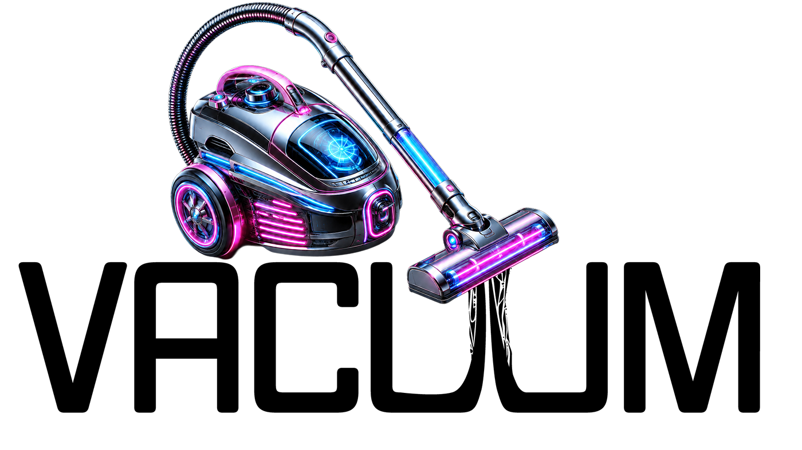
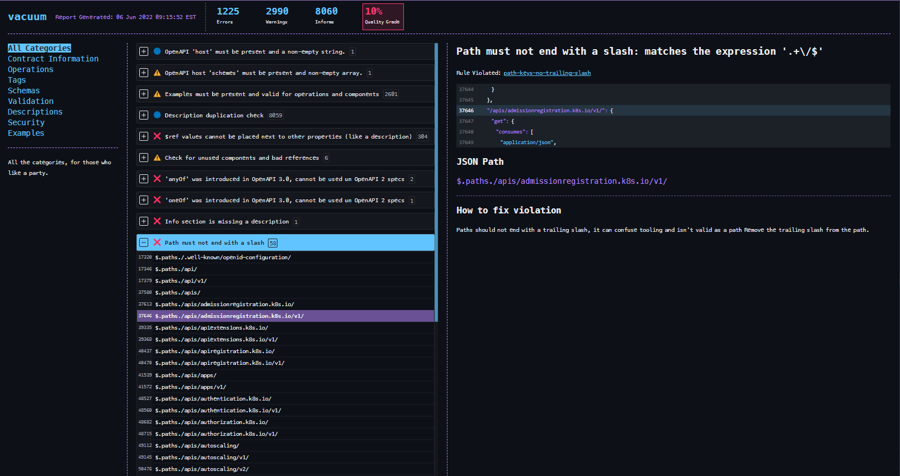

<picture>
  <source media="(prefers-color-scheme: dark)" srcset=".github/assets/logo-dark.png">
  
</picture>


# The world's fastest OpenAPI, AsyncAPI, Arazzo and JSON Schema linter.


[](https://discord.gg/UAcUF78MQN)
[](https://pkg.go.dev/github.com/daveshanley/vacuum)
[](https://www.npmjs.com/package/@quobix/vacuum)
[](https://hub.docker.com/r/dshanley/vacuum)
[](https://github.com/avelino/awesome-go)

An **ultra-super-fast**, lightweight OpenAPI, AsyncAPI, Arazzo and JSON Schema linter and quality checking tool inspired by [Spectral](https://github.com/stoplightio/spectral).

It supports Spectral-style YAML and JSON rulesets. See [Spectral migration](#spectral-migration) for compatibility limits and built-in alternatives.

## Install using the official [homebrew](https://brew.sh) tap

```
brew install --cask daveshanley/vacuum/vacuum
```

## Install using [npm](https://npmjs.com)

```
npm i -g @quobix/vacuum
```

## Install using [yarn](https://yarnpkg.com/)

```
yarn global add @quobix/vacuum
```

## Install using curl

```bash
curl -fsSL https://quobix.com/scripts/install_vacuum.sh | sh
```

### For CI/CD environments 

To avoid GitHub API rate limiting in automated environments, set a GitHub token:

```bash
# Using repository token (GitHub Actions)
GITHUB_TOKEN=${{ secrets.GITHUB_TOKEN }} curl -fsSL https://quobix.com/scripts/install_vacuum.sh | sh

# Using personal access token
GITHUB_TOKEN=your_github_token curl -fsSL https://quobix.com/scripts/install_vacuum.sh | sh
```

#### GitHub Actions example

```yaml
- name: Install vacuum
  env:
    GITHUB_TOKEN: ${{ secrets.GITHUB_TOKEN }}  # Increases rate limit from 60 to 5000 requests/hour
  run: |
    curl -fsSL https://quobix.com/scripts/install_vacuum.sh | sh
```

> **Note**: The GitHub token prevents intermittent installation failures in CI/CD environments caused by API rate limiting. 
> No additional permissions are required, the token only accesses public repository information.

## Install using [Docker](https://hub.docker.com/r/dshanley/vacuum)

The image is available at: https://hub.docker.com/r/dshanley/vacuum

```
docker pull dshanley/vacuum
```

> **Multi-platform support**: Docker images are available for both `linux/amd64` and `linux/arm64` architectures, including native ARM64 support for Apple Silicon Macs.

To run, mount the current working dir to the container and use a relative path to your spec, like so

```
docker run --rm -v $PWD:/work:ro dshanley/vacuum lint <your-openapi-spec.yaml>
```
Alternatively, you can pull it from
[GitHub packages](https://github.com/daveshanley/vacuum/pkgs/container/vacuum).
To do that, replace `dshanley/vacuum` with `ghcr.io/daveshanley/vacuum` in the above commands.

## Run with Go

If you have Go 1.26.10 or newer installed, you can use `go run` to build and run it:

```
go run github.com/daveshanley/vacuum@latest lint <your-openapi-spec.yaml>
```

## Upgrade vacuum

If vacuum was installed with Homebrew, npm, or the shell installer, run:

```bash
vacuum upgrade
```

vacuum will detect the install path and use the matching upgrade mechanism when it can. Normal commands may also show an
update notice when a newer stable release is available. The passive check keeps only a small temporary cache in the OS temp
directory, refreshed at most every 12 hours. Use `--no-update-check` or `VACUUM_NO_UPDATE_CHECK=true` to skip that check.

---

## Sponsors
If your company is using `vacuum`, please consider [supporting this project](https://github.com/sponsors/daveshanley),
like our _very kind_ sponsors, past and present:


<a href="https://scalar.com">
<picture>
  <source media="(prefers-color-scheme: dark)" srcset=".github/sponsors/scalar-dark.png">
  
</picture>
</a>

[scalar](https://scalar.com)

<a href="https://apideck.com">
<picture>
  <source media="(prefers-color-scheme: dark)" srcset=".github/sponsors/apideck-light.png">
  
</picture>
</a>

[apideck](https://apideck.com)

---

## Come chat with us

Need help? Have a question? Want to share your work? [Join our discord](https://discord.gg/UAcUF78MQN) and
come say hi!

## Documentation

🔥 **v0.40** 🔥: **Autofix**

Found problems? Can't be bothered to fix them? vacuum can auto-fix your linting issues for you.

Native JSON and YAML reports now include `diagnosticCode` when available. A security requirement can also name a scheme by URI in an external document that vacuum has already loaded.

- [Get started with autofix](https://quobix.com/vacuum/autofix/)
- [Save fixes as an overlay](https://quobix.com/vacuum/autofix/#save-as-an-overlay)
- [Supply your own values](https://quobix.com/vacuum/autofix-policy/)

---

`v0.40`: **OpenLint rulesets**

Got an OpenLint ruleset? Run it with `vacuum lint api.yaml --openlint -r rules.yaml`.

- [Using OpenLint rules with vacuum](https://quobix.com/vacuum/openlint/)

---

`v0.36`: **12 report output formats**

Export lint results in 12 formats, including SARIF, JUnit, GitLab Code Quality, HTML and Markdown.
Use `vacuum lint --format` to choose the output, or write multiple reports from one lint run.

- [Explore the report formats and examples](https://quobix.com/vacuum/commands/report/#more-report-formats)

---

`v0.34`: **Agent testing in vacuum**

A new `test` command gives agents a way to test rules, check changes and verify repairs using vacuum's existing engine.
Define a YAML or JSON suite, run `vacuum test suite.yaml`, and get structured results with evidence of what each rule actually did.

Check expected findings, selector matches and function calls. Test before-and-after changes, verify autofix output,
and check that running a fix again makes no further change. A clean result is only useful if the rule actually ran.

- [Get started with agent testing](https://quobix.com/vacuum/agent-testing/)
- [Read the `test` command reference](https://quobix.com/vacuum/commands/test/)
- [Read more about execution evidence](https://quobix.com/vacuum/testing/evidence/)
- [Use the test harness from Go](https://quobix.com/vacuum/api/test-harness/)

---

`v0.33`: **Arazzo workflow linting and a new `or` function**

Arazzo 1.0 and 1.1 workflows are now a first-class document type in vacuum, alongside OpenAPI, AsyncAPI and JSON Schema.
Use `vacuum lint workflows.yaml` and vacuum will detect Arazzo automatically, with recommended rules for workflow structure,
references, parameters, expressions and linked source documents. Results work in the normal reports, dashboard and editor diagnostics.

The new `or` core function checks that **at least one of two or more properties exists**. Use
`properties: [title, summary, description]` to require one of those fields. A property counts as present even when its
value is `null`, `false`, `0` or an empty string.

This release also fixes AsyncAPI header, server and version checks, and improves result locations for YAML aliases and shared references.

- [Read more about Arazzo linting in vacuum](https://quobix.com/vacuum/arazzo/)
- [See the default Arazzo ruleset](https://quobix.com/vacuum/rulesets/arazzo-recommended/)
- [Read more about the new `or` function](https://quobix.com/vacuum/functions/core/or/)

---

`v0.29`: **Lint AsyncAPI 3 documents in vacuum**

[AsyncAPI](https://www.asyncapi.com) is now a first-class document type in vacuum, alongside OpenAPI and JSON Schema.
Use the normal `lint` command and vacuum will detect AsyncAPI 3 documents automatically.

- [Read more about AsyncAPI linting in vacuum](https://quobix.com/vacuum/asyncapi/)
- [See the default AsyncAPI ruleset](https://quobix.com/vacuum/rulesets/asyncapi-recommended/)
- [See every built-in AsyncAPI rule](https://quobix.com/vacuum/rulesets/asyncapi/)
- [Generate an AsyncAPI ruleset](https://quobix.com/vacuum/commands/generate-ruleset/)
- [See the AsyncAPI functions](https://quobix.com/vacuum/functions/asyncapi/)

---

`v0.28`: **Lint JSON Schema documents in vacuum**

A new `schema` command has been added that opens up vacuum to JSON Schema specific linting rules and checks! 
With a whole new set of functions and rules, specifically for JSON Schema documents. 

Try it out on your own JSON Schema docs! with `vacuum schema`

- [Read more about JSON Schema linting in vacuum](https://quobix.com/vacuum/json-schema/)
- [Read the available `schema` command options](https://quobix.com/vacuum/commands/schema/)
- [See the new recommended JSON Schema ruleset](https://quobix.com/vacuum/rulesets/json-schema-recommended/)

---

`v0.27`: **Generate OpenAPI Documentation in vacuum**

A new `docs` command will generate the **best OpenAPI Documentation you ever saw**! Now vacuum has 
integrated with [the printing press](https://github.com/pb33f/printing-press), it means
generating documentation with built-in linting results is available _right inside vacuum_.

Try it out! instead of the `lint` command try the `docs` command instead.

- [Read more about API Docs in vacuum](https://quobix.com/vacuum/api-docs/)
- [Read the `docs` command reference](https://quobix.com/vacuum/commands/docs/)
- [Read more about the printing press](https://pb33f.io/printing-press/)
- [Learn about rendering modes](https://pb33f.io/printing-press/rendering-modes/)
- [Learn about diagnostics mode](https://pb33f.io/printing-press/diagnostics-mode/)
- [Learn about API catalogs](https://pb33f.io/printing-press/api-catalog/)
- [Learn about agentic AI output](https://pb33f.io/printing-press/agentic-ai/)
- [Learn about generated outputs](https://pb33f.io/printing-press/outputs/)

---

`v0.25`: **Generate Open Collections from OpenAPI files**

A new `open-collection` command will generate an [Open Collection](https://www.opencollection.com/) Workflow folder
(or bundled file)

Open Collection is a new standard for defining and sharing API collections. vacuum supports it natively.

[Read More](https://quobix.com/vacuum/commands/open-collection/)

---


See all the documentation at https://quobix.com/vacuum

- [Installing vacuum](https://quobix.com/vacuum/installing/)
- [About vacuum](https://quobix.com/vacuum/about/)
- [Why should you care?](https://quobix.com/vacuum/why/)
- [Concepts](https://quobix.com/vacuum/concepts/)
- [FAQ](https://quobix.com/vacuum/faq/)
- [Linting AsyncAPI](https://quobix.com/vacuum/asyncapi/)
- [Ignoring lint results](https://quobix.com/vacuum/ignoring/)
- [Generate API Docs](https://quobix.com/vacuum/api-docs/)
- [Linting JSON Schema](https://quobix.com/vacuum/json-schema/)
- [Autofix!](https://quobix.com/vacuum/autofix/)
  - [Autofix! Policies](https://quobix.com/vacuum/autofix-policy/)
- [CLI Commands](https://quobix.com/vacuum/commands/)
  - [lint](https://quobix.com/vacuum/commands/lint/)
  - [vacuum report](https://quobix.com/vacuum/commands/report/)
  - [docs](https://quobix.com/vacuum/commands/docs/)
  - [dashboard](https://quobix.com/vacuum/commands/dashboard/)
  - [html-report](https://quobix.com/vacuum/commands/html-report/)
  - [bundle](https://quobix.com/vacuum/commands/bundle/) - OpenAPI and AsyncAPI 3, with inline and composed output.
  - [spectral-report](https://quobix.com/vacuum/commands/spectral-report/)
  - [language-server](https://quobix.com/vacuum/commands/language-server/)
  - [upgrade](https://quobix.com/vacuum/commands/upgrade/)
  - [apply-overlay](https://quobix.com/vacuum/commands/apply-overlay/)
  - [schema](https://quobix.com/vacuum/commands/schema/)
  - [Change Detection](https://quobix.com/vacuum/commands/change-detection/)
  - [open-collection](https://quobix.com/vacuum/commands/open-collection/)
  - [generate-ruleset](https://quobix.com/vacuum/commands/generate-ruleset/)
  - [version](https://quobix.com/vacuum/commands/version/)
  - [External References](https://quobix.com/vacuum/commands/external-references/)
  - [Exit Codes](https://quobix.com/vacuum/commands/exit-codes/)
- [Developer API](https://quobix.com/vacuum/api/getting-started/)
  - [Using The Index](https://quobix.com/vacuum/api/spec-index/)
  - [RuleResultSet](https://quobix.com/vacuum/api/rule-resultset/)
  - [Loading a RuleSet](https://quobix.com/vacuum/api/loading-ruleset/)
  - [Linting Non-OpenAPI Files](https://quobix.com/vacuum/api/non-openapi/)
  - [Custom Golang Functions](https://quobix.com/vacuum/api/custom-functions/)
  - [Custom JavaScript Functions](https://quobix.com/vacuum/api/custom-javascript-functions/)
- [Rules](https://quobix.com/vacuum/rules/)
  - [Examples](https://quobix.com/vacuum/rules/examples/)
  - [Tags](https://quobix.com/vacuum/rules/tags/)
  - [Descriptions](https://quobix.com/vacuum/rules/descriptions/)
  - [Schemas](https://quobix.com/vacuum/rules/schemas/)
  - [Spec Information](https://quobix.com/vacuum/rules/information/)
  - [Operations & Paths](https://quobix.com/vacuum/rules/operations/)
  - [Channels](https://quobix.com/vacuum/rules/channels/)
  - [Messages](https://quobix.com/vacuum/rules/messages/)
  - [Servers](https://quobix.com/vacuum/rules/servers/)
  - [Validation](https://quobix.com/vacuum/rules/validation/)
  - [Security](https://quobix.com/vacuum/rules/security/)
  - [OWASP](https://quobix.com/vacuum/rules/owasp/)
- [Functions](https://quobix.com/vacuum/functions/)
  - [Core Functions](https://quobix.com/vacuum/functions/core/) 
  - [OpenAPI Functions](https://quobix.com/vacuum/functions/openapi/)
  - [OWASP Functions](https://quobix.com/vacuum/functions/owasp/)
  - [AsyncAPI Functions](https://quobix.com/vacuum/functions/asyncapi/)
- [Understanding RuleSets](https://quobix.com/vacuum/rulesets/understanding/)
  - [Sharing RuleSets](https://quobix.com/vacuum/rulesets/sharing/)
  - [All Rules](https://quobix.com/vacuum/rulesets/all/)
  - [No Rules](https://quobix.com/vacuum/rulesets/no-rules/)
  - [Recommended Rules](https://quobix.com/vacuum/rulesets/recommended/)
  - [AsyncAPI Default Rules](https://quobix.com/vacuum/rulesets/asyncapi-recommended/)
  - [AsyncAPI All Rules](https://quobix.com/vacuum/rulesets/asyncapi/)
  - [Custom Rules](https://quobix.com/vacuum/rulesets/custom-rulesets/)
  - [OpenLint](https://quobix.com/vacuum/openlint/)

---

> **vacuum is an all in one power tool for API architects and engineers.**

Designed to reliably lint API descriptions, **very, very quickly**. Including _very large_ ones. Spectral can be quite slow
when used as an API and does not scale for enterprise applications.

vacuum will tell you what is wrong with your spec, why, where, and how to fix it. 

vacuum will work at scale and is designed as a CLI (with a web or console UI) and a library to be consumed in other applications.

### Dashboard

vacuum comes with an interactive dashboard (`vacuum dashboard <your-openapi-spec.yaml>`) allowing you to explore
rules and violations in a console, without having to scroll through thousands of results.

<a href="https://quobix.com/vacuum/commands/dashboard/">
<picture>
  <source media="(prefers-color-scheme: dark)" srcset=".github/assets/dashboard.gif">
  
</picture>
</a>

To read about the dashboard, see the [dashboard command docs](https://quobix.com/vacuum/commands/dashboard/).

### HTML Report

vacuum can generate an easy to navigate and understand HTML report. Like the dashboard
you can explore broken rules and violations, but in your browser.

No external dependencies, the HTML report will run completely offline.



---

> **_Supports OpenAPI Version 2, OpenAPI Version 3+, AsyncAPI 3, and JSON Schema documents_**

You can use either **YAML** or **JSON**, vacuum supports both formats.

## Using vacuum with pre-commit

vacuum can be used with [pre-commit](https://pre-commit.com).

To do that, add to your `.pre-commit-config.yaml`:

```yaml
repos:
  - repo: https://github.com/daveshanley/vacuum
    rev: # a tag or a commit hash from this repo, see https://github.com/daveshanley/vacuum/releases
    hooks:
      - id: vacuum
```

See the [hook definition](./.pre-commit-hooks.yaml) here for details on what options the hook uses and what files it checks by default.

If no filenames or more than one filename in your repository matches the default `files` pattern in the hook definition,
the pattern needs to be overridden in your config so that it matches exactly one filename to lint at a time.
To lint multiple files, specify the hook multiple times with the appropriate overrides.

## Build an interactive HTML report 

`vacuum html-report` is included in official release binaries. If you install via `go install github.com/daveshanley/vacuum@<version>`, the command is compiled without the HTML report UI bundles. To enable it from source, run `./scripts/build-ui-assets.sh` and build with `-tags html_report_ui`.

```
./vacuum html-report <your-openapi-spec.yaml | vacuum-report.json.gz> <report-name.html>
```

You can replace `report-name.html` with your own choice of filename. Open the report
in your favorite browser and explore the results. 


## See full linting report 

```
./vacuum lint -d <your-openapi-spec.yaml>
```


## Lint multiple files at once

```
./vacuum lint -d <spec1.yaml> <spec2.yaml> <spec3.yaml>
```

## Lint multiple files using a glob pattern

```
./vacuum lint -d some/path/**/*.yaml
```

## See full linting report with inline code snippets

```
./vacuum lint -d -s <your-openapi-spec.yaml>
```

## See just the linting errors

```
./vacuum lint -d -e <your-openapi-spec.yaml>
```

## See just a specific category of report


```
./vacuum lint -d -c schemas <your-openapi-spec.yaml>
```

The options here are:

- `examples`
- `operations`
- `information`
- `descriptions`
- `schemas`
- `security`
- `tags`
- `validation`
- `owasp`

## Generate a Spectral compatible report

If you're already using Spectral JSON reports, and you want to use vacuum instead, use the `spectral-report` command

```
./vacuum spectral-report <your-openapi-spec.yaml> <report-output-name.json>
```

The report file name is _optional_. The default report output name is `vacuum-spectral-report.json`


## Generate a `vacuum report`

vacuum reports are complete snapshots in time of a linting report for a specification. These reports can be 'replayed'
back through vacuum. Use the `dashboard` or the `html-report` commands to 'replay' the report and explore the results
as they were when the report was generated.

```
./vacuum report -c <your-openapi-spec.yaml> <report-prefix>
```

The default name of the report will be `vacuum-report-MM-DD-YY-HH_MM_SS.json`. You can change the prefix by supplying
it as the second argument to the `report` command. 

Ideally, **you should compress the report using `-c`**. This shrinks down the size significantly. vacuum automatically
recognizes a compressed report file and will deal with it automatically when reading.

> When using compression, the file name will be `vacuum-report-MM-DD-YY-HH_MM_SS.json.gz`. vacuum uses gzip internally.

## Selecting property names in custom rules

Use quoted bracket notation for JSONPath property names with special characters, for example `['$ref']` and `['application/json']`. A single leading backtick also escapes a member name in dot notation or an unquoted bracket selector:

~~~text
$.paths.*.*.requestBody.content.`application/json.schema.`$ref
~~~

There is no closing backtick; a trailing backtick becomes part of the property name. Use quoted bracket notation for names that contain path separators or whitespace, and for properties inside filters. Quoted names keep literal backticks unchanged.

To inspect a `$ref` property itself, set `resolved: false`. With `resolved: true`, rules inspect the referenced schema after resolution.

```yaml
rules:
  no-request-body-refs:
    description: Request body schemas must be inline.
    given: "$.paths.*.*.requestBody.content['application/json'].schema['$ref']"
    resolved: false
    severity: warn
    then:
      function: falsy
```

## Ignoring specific linting errors

You can ignore specific linting errors by providing an `--ignore-file` argument to commands that run or replay lint results, including `lint`, `report`, `spectral-report`, `html-report`, `dashboard`, `docs`, `schema`, and `language-server`.

```
./vacuum lint --ignore-file <path-to-ignore-file.yaml> -d <your-openapi-spec.yaml>
```

```
./vacuum report --ignore-file <path-to-ignore-file.yaml> -c <your-openapi-spec.yaml> <report-prefix>
```

Repeat `--ignore-file` to combine waivers from multiple files. Paths for the same rule are appended; an unreadable or invalid file stops the command.

```sh
./vacuum lint --ignore-file pets-ignore.yaml --ignore-file stores-ignore.yaml api.yaml
```

In `vacuum.conf.yaml`, `ignore-file` accepts either one path or a YAML list of paths. A scalar value, including `VACUUM_IGNORE_FILE`, is always one path; commas are part of the filename.

Language-server editor settings accept `ignoreFiles: ["one.yaml", "two.yaml"]`; the legacy `ignoreFile` string still works. An empty `ignoreFiles` list clears waivers. Explicit CLI ignore files override disk config; editor initialization and workspace settings can override the CLI defaults.

The ignore-file should point to a `.yaml` file that contains exact result paths or JSONPath expressions to be ignored by vacuum. The structure of the YAML file is as follows:

```
<rule-id-1>:
  - <json_path_to_error_or_warning_1>
  - <json_path_to_error_or_warning_2>
<rule-id-2>:
  - <json_path_to_error_or_warning_1>
  - <json_path_to_error_or_warning_2>
  ...
```

Ignoring errors is useful for when you want to implement new rules to existing production APIs. In some cases, 
correcting the lint errors would result in a breaking change. Having a way to ignore these errors allows you to implement
the new rules for new APIs while maintaining backwards compatibility for existing ones.

---

## Try out the dashboard

This is an early, but working console UI for vacuum. The code isn't great, it needs a lot of clean up, but
if you're interested in seeing how things are progressing, it's available.

```
./vacuum dashboard <your-openapi-spec.yaml | vacuum-report.json.gz>
```

---
## OWASP hard mode

Run `vacuum lint --hard-mode api.yaml` to enable all built-in OpenAPI rules,
including the OWASP rules. Hard mode checks:

- OAuth [password](https://quobix.com/vacuum/rules/owasp/owasp-oauth-no-password/)
  and [implicit](https://quobix.com/vacuum/rules/owasp/owasp-oauth-no-implicit/) flows.
- [Authentication endpoint URLs](https://quobix.com/vacuum/rules/owasp/owasp-auth-urls-https/)
  and server URLs for HTTPS, including overrides and server variables.
- Request objects for unrestricted fields and maps for property-count limits.
- Write operations for authenticated security requirements, without anonymous alternatives.
- Declared JWTs for an RFC8725 reference in their description, as a warning.

**Changes for existing users:** strict write security now reports an **error**,
previously informational. A requirement such as `security: [{auth: []}, {}]` can
now fail a build. Also, `x-lint-ignore` applies to the entire subtree beneath its
location for every ruleset, rather than only the node and its immediate children.

See the [OWASP guide](https://quobix.com/vacuum/rulesets/owasp/) for rule details
and severity overrides, and [ignoring violations](https://quobix.com/vacuum/ignoring/)
for scoped exceptions.

---

## Spectral migration

vacuum loads YAML, JSON, and local JavaScript rulesets. Resolve each relative `extends` path from the
file that contains it, including on Windows. Keep sibling rulesets relative:

```yaml
extends:
  - ./ruleset.bank.yml
  - ./ruleset.nlgov.yml
  - [vacuum:owasp, all]
```

Use `[vacuum:owasp, all]` for vacuum's built-in OWASP checks instead of importing
`@stoplight/spectral-owasp-ruleset/dist/ruleset.mjs`. The native rules use vacuum's
rule names and behavior; they do not execute the Spectral package.

For JavaScript rulesets, export an object from a local `.js`, `.mjs`, or `.cjs` file:

```shell
vacuum lint api.yaml -r rules.mjs
```

Functions, static imports, Promises, and callable formats run in an isolated runtime
for each document. See [JavaScript rulesets](https://quobix.com/vacuum/rulesets/javascript/)
for supported imports, context, and migration limits.

Arazzo 1.0 and 1.1 workflows use `vacuum lint workflows.yaml` and the normal
report commands. `spectral:arazzo` selects Vacuum's native recommended rules.
See [Arazzo linting](ARAZZO.md) for source lookup, rule IDs, incomplete checks
and migration differences.

`--functions` takes a directory containing custom function files:

```shell
vacuum lint api.yaml --ruleset rules/main.yaml --functions ./functions
```

JavaScript ruleset functions do not need this directory. Omitting the directory after `--functions` reports an
input error and exits with code 2. In the editor, vacuum checks recognized ruleset
buffers against its ruleset schema instead of reporting an unsupported API type.

## Supply your own Spectral compatible ruleset

If you're already using Spectral and you have your own [custom ruleset](https://meta.stoplight.io/docs/spectral/e5b9616d6d50c-custom-rulesets#custom-rulesets),
then you can use it with vacuum! 

The `lint`, `dashboard`, `docs`, `html-report`, `report`, and `spectral-report` commands all accept a `-r` or `--ruleset` flag, defining the path to your ruleset file.

### Here are some examples you can try

**_All rules turned off_**
```
./vacuum lint -r rulesets/examples/norules-ruleset.yaml <your-openapi-spec.yaml>
```

**_Only recommended rules_**
```
./vacuum lint -r rulesets/examples/recommended-ruleset.yaml <your-openapi-spec.yaml>
```

**_Enable specific rules only_**
```
./vacuum lint -r rulesets/examples/specific-ruleset.yaml <your-openapi-spec.yaml>
```

**_Custom rules_**
```
./vacuum lint -r rulesets/examples/custom-ruleset.yaml <your-openapi-spec.yaml>
```

**_All rules, all of them!_**
```
./vacuum lint -r rulesets/examples/all-ruleset.yaml <your-openapi-spec.yaml>
```

---

## Reference resolution in rules

vacuum has two resolved-execution controls:

- Per rule: `resolved`
- Per run: `--resolve-all-refs` or `motor.ExecutionOptions{ResolveAllRefs: true}`

In YAML/JSON rulesets, `resolved` defaults to `true`. In that mode, `given`, matched nodes, `Index`, and `SpecInfo` come from the dereferenced document, but `context.Document` stays unresolved for compatibility.

Set `resolved: false` when a rule needs the raw document, for example to inspect `$ref` directly. If you build `model.Rule` values in Go, set `Resolved` explicitly.

```yaml
rules:
  response-has-content:
    given: "$.paths[*][*].responses['404']"
    resolved: false
    then:
      field: content
      function: defined
```

`--resolve-all-refs` forces every rule into resolved execution, overrides `resolved: false`, and also supplies resolved `context.Document` to rule functions.

Use `--nested-refs-doc-context` or `motor.ExecutionOptions{NestedRefsDocContext: true}` for split specs where an external file contains another relative `$ref`. That makes nested relative refs resolve from the referenced document instead of the root document. It only affects resolved execution, including runs forced by `--resolve-all-refs`.

---

## Configuration

### File
You can configure vacuum using a configuration file named `vacuum.conf.yaml`

By default, vacuum searches for this file in the following locations:
1. Working directory
2. `$XDG_CONFIG_HOME`, when set
3. `${HOME}/.config`, when `$XDG_CONFIG_HOME` is not set

You can also specify a path to a file using the `--config` flag

Global flags are configured as top level nodes
```yaml
time: true
base: 'http://example.com'
...
```
Command specific flags are configured under a node with the commands name
```yaml
...
lint:
  silent: true
  ...
```

> [!TIP]
> When using `vacuum` as a library You can access the fixed yaml content in the `RuleSetExecutionResult.ModifiedSpec`, and choose where to write the file.
> 
> When using `vacuum` as a cli, the `--fix` flag will overwrite the spec file in place, and `--fix-file` flag lets you specify an alternative file to write the content to, if you want to compare the outputs.

### Usage


> Logo gopher is modified, originally from [egonelbre](https://github.com/egonelbre/gophers)
